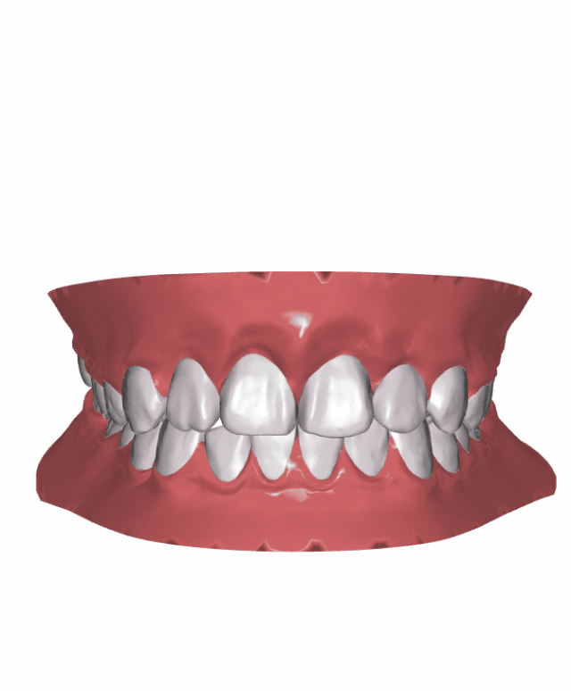

# 正畸动画预览 Demo

这是一个基于 Three.js 的静态三维正畸动画预览程序。它加载预先生成的牙齿和牙龈动画帧，用于查看上下颌在不同步骤中的变化。

## 目录结构

```text
ortho/
├─ index.htm                         # 演示入口
├─ docs/
│  └─ ortho-animation.gif             # 示例动画截图
├─ data/
│  └─ 20181128175620378388/
│     └─ clip/
│        ├─ config.json              # 帧数、牙齿数量和上下颌索引
│        ├─ Up/*.ctm                 # 上颌牙龈帧
│        ├─ Down/*.ctm               # 下颌牙龈帧
│        └─ Tooth/*.ctm              # 28 颗牙齿基础网格
└─ web/
   ├─ css/main.css                   # 页面样式
   ├─ img/                           # 控制按钮图片
   └─ js/
      ├─ main.js                     # Three.js 场景和播放逻辑
      └─ libs/                       # Three.js、CTMLoader、GIF 编码器和相关依赖
```

## 演示截图



## 启动

不要直接双击 `index.htm`，因为浏览器可能限制本地文件读取。使用本地 HTTP 服务启动：

```powershell
cd F:\My_Github\正畸流程\ortho
uv run --no-project python -m http.server 18976
```

然后打开：

```text
http://127.0.0.1:18976/index.htm
```

## 播放逻辑

- `config.json` 定义 28 颗牙和 6 个动画步骤。
- `AxisInfo.json` 保存每一步每颗牙的变换矩阵。
- `Tooth/*.ctm` 是牙齿基础网格，加载后根据矩阵复制到各动画步骤。
- `Up/*.ctm` 和 `Down/*.ctm` 是上下颌牙龈的预计算帧。
- 播放时只切换不同帧对象的 `visible` 状态，不重新进行排牙计算。
- CTM 由 `CTMLoader.js` 和 `CTMWorker.js` 在浏览器中解压加载。

## 操作

- 播放/暂停：播放按钮
- 上一帧/下一帧：左右箭头
- 拖动进度条：跳转到指定步骤
- 上视图、下视图、前视图、左右视图：切换相机
- 鼠标拖动：旋转三维模型
- 保存 GIF：按当前视角导出 6 帧动画，浏览器会自动下载 `ortho-animation.gif`

仓库中已保存一份示例动画：[docs/ortho-animation.gif](docs/ortho-animation.gif)。

## 说明

这个 Demo 不包含训练、推理或实时牙弓计算。动画结果已经提前写入 `AxisInfo.json` 和各个 CTM 帧文件中，网页只负责加载、渲染和播放。

GIF 导出使用 `gif.js`，相关文件已放在 `web/js/libs/`，因此 Demo 不依赖外部 CDN。
